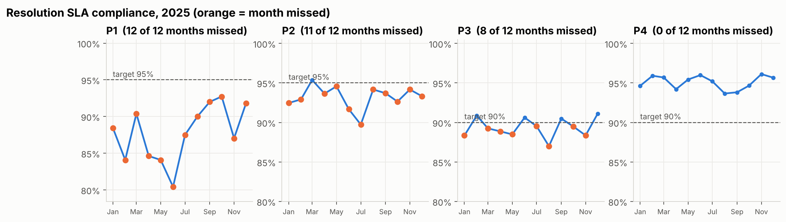
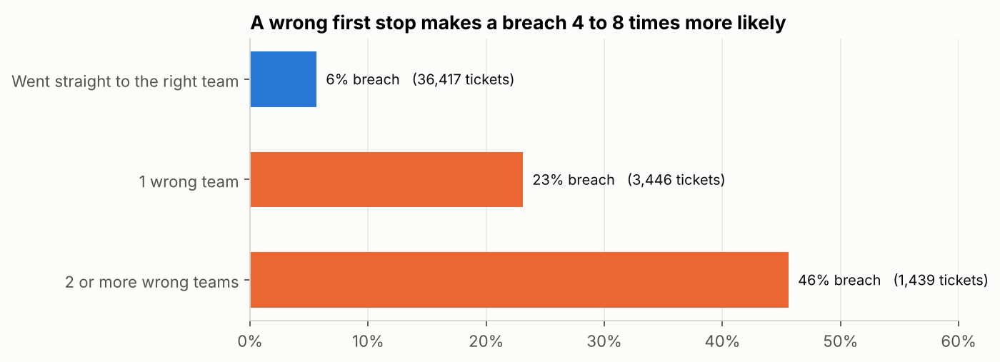
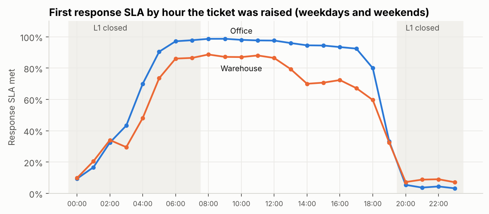

# IT Service Desk SLA Analysis

Why does an outsourced IT service desk keep missing its SLAs, and what is that costing?

I analysed a year of service desk tickets (42,285 of them) for a logistics company whose IT support is run by
a managed service provider. The provider pays money back as service credits every month it misses an SLA
target. In 2025 that came to **₹29.45 lakh**.

The analysis shows that two process changes, with no new hires, would have cut that by more than half.



## What I found

**Tickets that go to the wrong team first cause 41.5% of all breaches**, while being only 11.8% of tickets.
A ticket that bounces once breaches 23% of the time, against 5.6% for one that goes straight to the right team.
Almost all of the extra time is spent waiting in the wrong queue with nobody working on it.



**A reopened P1 or P2 is a guaranteed breach.** 98% of reopened P1/P2 tickets miss SLA, and reopens are
behind 76% of P2 breaches. Desktop Support reopens 13.6% of its tickets (other teams: about 4%), and the rate
is about the same for every engineer in the team, which points at how the team closes tickets.

**The warehouses work at night. L1 doesn't.** 64% of warehouse tickets arrive while L1 is closed and only a
third of them get a response inside SLA. Staff locked out at night wait a median of 9.6 hours for a password reset.



**Two one-off events show up clearly:** a VPN client update that tripled VPN tickets for six weeks and slowed
the whole network team, and a finance month-end spike that doubles ERP tickets every month.

| Change | 2025 credits | Saving |
|---|---|---|
| As it was | ₹29.45 lakh | |
| Engineers confirm the fix with the user before closing | ₹15.20 lakh | ₹14.25 lakh |
| Routing guide for the 10 most misrouted ticket types | ₹25.65 lakh | ₹3.80 lakh |
| Both | ₹13.30 lakh | ₹16.15 lakh |

The full write-up, with the P1 problem these changes don't fix, is in
[reports/findings_memo.md](reports/findings_memo.md).

## About the data

The data is **simulated**. Real service desk data is confidential, so I wrote a generator
(`src/generate_data.py`) that models how a service desk actually works: team shift hours, queue waits,
L1 triage that sometimes guesses wrong, reopens, Indian public holidays, month-end load. The patterns
above come out of those mechanics. I didn't type them into a spreadsheet.

I also put in the kind of mess you get from a real ServiceNow export, so the cleaning step has real work to do:

- 169 duplicate rows from an export retry
- category values in mixed case and with trailing spaces
- a monitoring integration that wrote resolution times in **UTC instead of IST** for six weeks

That last one was the most interesting part of the cleaning. It showed up as 448 tickets "resolved before
they were opened", all from the same channel and the same six weeks. Checking against the audit log showed the
gap was exactly 5 hours 30 minutes, and that 538 tickets were affected, not 448. Fixing only the negative ones
would have left 90 wrong rows in. Details are in `sql/02_data_quality_checks.sql`.

Every commercial number (contract fee, staff cost, SLA targets) is an assumption, and they're all in
`src/settings.py` so they're easy to challenge.

## How it's built

| Step | What | File |
|---|---|---|
| 1 | Generate a year of tickets and an audit log of every assignment | `src/generate_data.py` |
| 2 | Load into PostgreSQL (raw layer, mess included) | `src/load_to_postgres.py`, `sql/01_schema.sql` |
| 3 | Find the data problems | `sql/02_data_quality_checks.sql` |
| 4 | Clean and build one fact table with all SLA logic | `sql/03_clean.sql` |
| 5 | Answer the business questions in SQL | `sql/04_analysis_queries.sql` |
| 6 | Star schema views for Power BI | `sql/05_powerbi_views.sql` |
| 7 | Statistics, charts and the money scenarios | `notebooks/sla_analysis.ipynb` |
| 8 | Dashboard build notes and DAX | `powerbi/README.md` |
| 9 | Findings and recommendations | `reports/findings_memo.md` |

SQL techniques used: CTEs, window functions (`LEAD`, `RANK`, `NTILE`, running totals for a Pareto),
`DISTINCT ON`, `FILTER` clauses, `PERCENTILE_CONT`, `ROLLUP`, and rebuilding how long each ticket sat with
each team from the event log.

On the statistics side: chi-square tests, Mann-Whitney U (resolution times are too skewed for a t-test), and a
logistic regression to check that bounced tickets breach more *because* they bounced, and that the effect
isn't explained by them being harder tickets to begin with. After controlling for priority, ticket type, team and time of day, a bounce
still multiplies the odds of a breach by about 10.

## Run it yourself

You need Python 3.10+ and PostgreSQL 14+.

```bash
git clone https://github.com/varshan1805/IT-Service-desk-SLA-Analysis.git
cd IT-Service-desk-SLA-Analysis
pip install -r requirements.txt

python src/generate_data.py          # writes data/raw/*.csv (about 15 seconds)
createdb servicedesk
python src/load_to_postgres.py       # loads, cleans, builds the Power BI views

jupyter notebook notebooks/sla_analysis.ipynb
```

Just want the dashboard? You don't need Postgres for that. The tables Power BI uses are already exported
to `powerbi/data/` as CSVs, and `powerbi/README.md` walks through the build.

If your Postgres user or password isn't the default, set `PGUSER`, `PGPASSWORD`, `PGHOST` and `PGPORT`
before running the loader and the notebook. The generator uses a fixed seed, so you'll get exactly the
numbers in this README.

## Repo layout

```
├── data/raw/                 generated CSVs (tickets, events, employees, agents, groups, SLA policy)
├── images/                   charts used in this README
├── notebooks/                analysis notebook
├── powerbi/                  dashboard build notes, DAX measures, and the model tables as CSV
├── reports/                  findings memo and key_numbers.json
├── sql/                      schema, data quality checks, cleaning, analysis, Power BI views
└── src/                      generator, loader, settings
```

## What I'd do next with real data

- Pull the carrier/vendor field for P1 site outages to see how much of the P1 problem is outside the
  service desk's control.
- Use the ticket text to suggest the right team at the moment a ticket is logged, instead of relying on
  L1 to guess.
- Track the confirm-before-close change for a month and compare reopen rates before and after, rather than
  relying on the 50% assumption.
